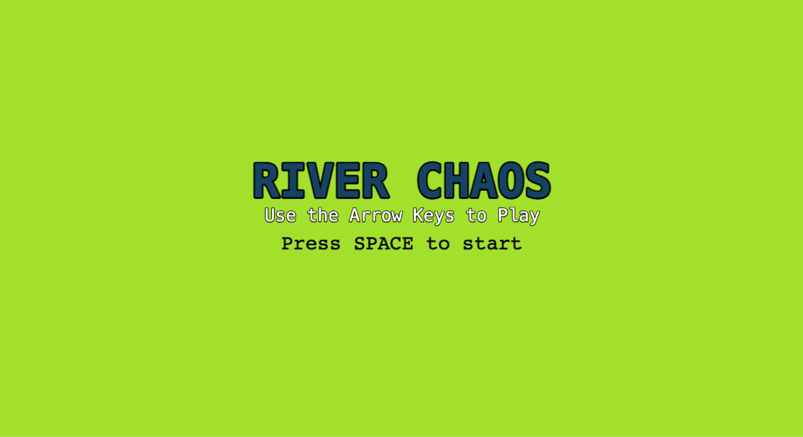
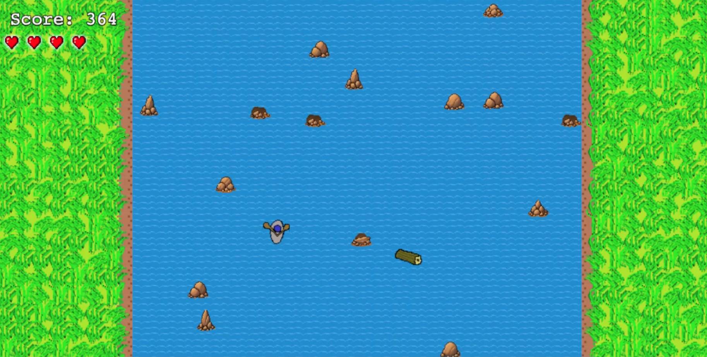
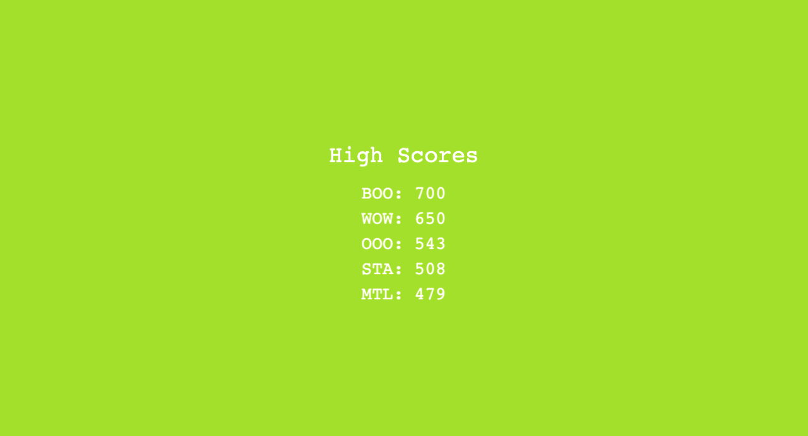

# River Chaos

River Chaos is a fast-paced browser arcade game I built with JavaScript and Phaser. Row your boat down a treacherous river, dodge obstacles and survive long enough to earn a spot on the leaderboard.

🕹️ **[Play River Chaos](https://www.riverchaos.com)** (Desktop only)

What started as a simple arcade game, grew into a full-stack application featuring a persistent leaderboard, a Node.js/Express backend, a MySQL database and AWS cloud infrastructure.

---

## Architecture

```text
Browser
  ├─ HTTPS → CloudFront → S3: Vite-built game and assets
  └─ HTTPS → CloudFront → Elastic Beanstalk (single instance)
                           └─ nginx → Express → MySQL on RDS
                                                verified TLS
```

## Tech Stack

| Layer       | Technologies                                                    |
| ----------- | --------------------------------------------------------------- |
| Game client | JavaScript ES modules, Phaser 3, Arcade Physics, Vite, HTML/CSS |
| API         | Node.js, Express 5, express-rate-limit                          |
| Persistence | MySQL, mysql2 connection pooling, UUID run identifiers          |
| Hosting     | Amazon S3, CloudFront, Elastic Beanstalk, RDS MySQL             |

## Gameplay

Use the arrow keys to row your boat down the river while avoiding rocks and spinning logs. The player starts with five hearts and obstacles become more frequent as your score increases.

The game features animated water, moving grass that changes color with the score, changing scenery and background music. After each run, you can submit your initials and compete for a spot on the global leaderboard. Scores persist on the backend, so if you get a high score it will stay until someone else clears it.

## Screenshots







## API and Database

| Endpoint                           | Behavior                                                                                                             |
| ---------------------------------- | -------------------------------------------------------------------------------------------------------------------- |
| `POST /api/runs`                   | Saves a run and returns its generated ID with HTTP `201`.                                                            |
| `GET /api/leaderboard?limit=10`    | Returns each player's best score, preferring the earliest run on a score tie. Limit defaults to 10 and accepts 1–50. |
| `GET /api/players/:playerId/stats` | Returns run count, best/average score, and total playtime.                                                           |
| `GET /health`                      | Checks HTTP-server availability; does not check database connectivity.                                               |

## Security

The backend includes input validation and rate limiting to help protect the API from invalid requests and abuse. Database queries use parameterized SQL and connections to the production database are encrypted using TLS.

Database credentials are stored in environment variables rather than source code.
